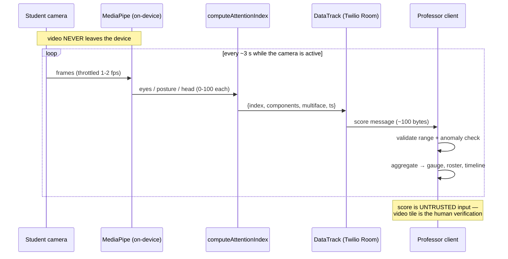
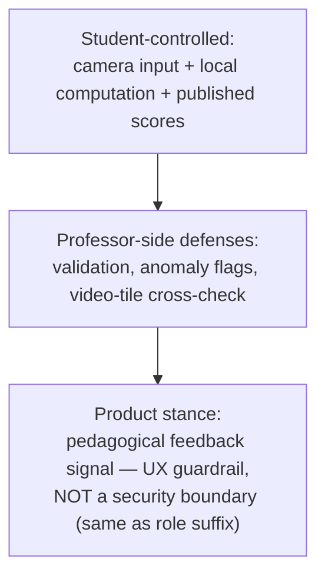

# Attention CV pipeline — proposed architecture

Distributed client-side analysis: each student analyzes their own camera locally;
only derived scores travel over Twilio DataTracks; the professor aggregates and
treats every score as untrusted input. Video never leaves the student's device.

Students have **no attention UI and no control over the analysis** (product
decision, 2026-06-12 — the "Mi Atención" panel and the `enabled` pause toggle
were removed). The student-side privacy story is transparency, not control:
the prejoin privacy notice, the `/security` page, and the guarantee that video
never leaves the device. Analysis runs whenever the student is in the room with
an active camera.

## Component / data-flow view

```mermaid
flowchart LR
    subgraph student["STUDENT browser (x N — each analyzes only itself)"]
        cam["Local camera<br/>(full resolution)"]
        subgraph mp["MediaPipe Tasks Vision (WASM, on-device)"]
            face["FaceLandmarker<br/>~1-2 fps<br/>eyes / gaze / blink<br/>head pitch-yaw-roll<br/>numFaces → multiface"]
            pose["PoseLandmarker<br/>every 2-3 s<br/>posture"]
        end
        smooth["Smoothing window ~10 s"]
        formula["computeAttentionIndex<br/>0.40*eyes + 0.30*posture + 0.30*head"]
        payload["Score payload ~100 bytes<br/>{index, components, level,<br/>multiface, lighting, ts}"]
        dt["LocalDataTrack publish<br/>every ~3 s<br/>(same pattern as useRaiseHand)"]

        cam --> mp
        face --> smooth
        pose --> smooth
        smooth --> formula
        formula --> payload
        payload --> dt
    end

    subgraph twilio["Twilio Room (SFU)"]
        room["DataTracks +<br/>video/audio tracks"]
    end

    subgraph prof["PROFESSOR browser (zero CV)"]
        sub["Subscribe remote DataTracks"]
        guard["Untrusted-input checks:<br/>1. range/shape validation<br/>2. anomaly flags (flat variance,<br/>pinned at 100, perfect period)<br/>3. correlate vs video track state"]
        agg["AttentionProvider aggregation<br/>source: 'mock' → 'live'"]
        ui["Group gauge / roster badges /<br/>timeline / proctoring alerts"]
        tile["Video tiles = human<br/>ground truth next to score"]

        sub --> guard --> agg --> ui
        tile -.-> ui
    end

    dt -- "scores only,<br/>~1 KB/s total for 30 students" --> room
    room --> sub

    backend["Future epic (NOT now):<br/>POST scores for post-class reports<br/>(token server candidate)"]
    agg -.-> backend

    style backend stroke-dasharray: 5 5
    style guard fill:#fff3cd,stroke:#b8860b
    style mp fill:#e8f4ea,stroke:#2e7d32
```

## Message-flow view (one student, steady state)

## Trust boundaries

